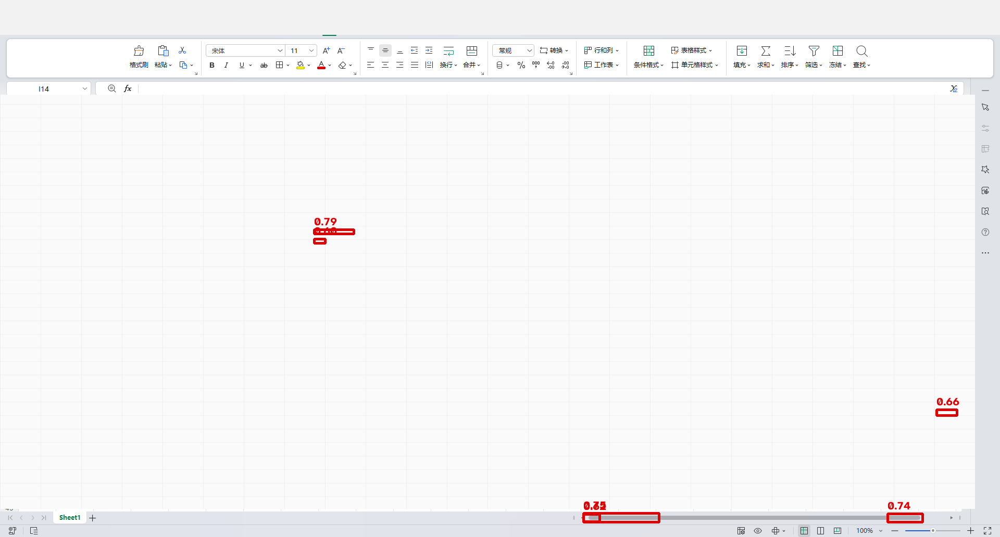
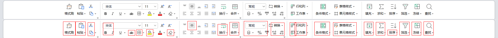
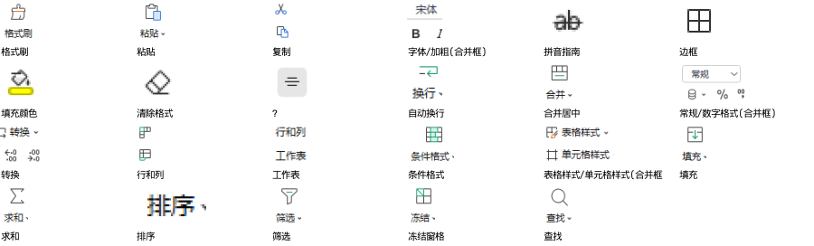
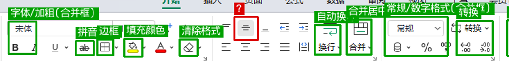

# 视觉 RPA 开发实践结论 v0.1

> 2026-10-09
> 以一个真实电子表格软件（下称「目标软件」）为对象，完整走了一遍「视觉识别 → 自动操作」的链路，
> 含帮助文档抓取、操作数据集构建、按钮模板提取与实机验证。
> **结论基于实测数据，不是推演**；文中配图均为实机/实测截图。

---

## 一、做了什么

### 1. 建立操作知识底座

- 抓取目标软件官方帮助中心全部条目：**351 篇**（图文 239 + 问答 112），正文 100% 有效
- 从正文抽出结构化操作指令：**666 条**，覆盖四种句式（引号链 / 破折号链 / 【】式 / 方位描述）
- 用配图补全正文没说清的控件位置：**607 条（91%）**定出了所属选项卡
- 按「要到界面哪一层才能碰到该控件」分类：

  | 层级 | 条数 | 占比 |
  |---|---|---|
  | 功能区直接可见 | 278 | **41%** |
  | 对话框内控件 | 164 | 24% |
  | 下拉菜单项 | 100 | 15% |
  | 右键菜单项 | 45 | 7% |
  | 未定位 | 45 | 7% |
  | 工作表界面 | 34 | 5% |

### 2. 试着把帮助文档的图变成按钮模板 —— **失败**

- 从 284 张依据截图裁出 184 个控件图（系统内置 OCR + 词跨度匹配）
- **实机验证**：拿 10 张裁图对本机实机截图跑多尺度模板匹配，
  名义得分 0.59–0.79，**画框一看全是假阳性**

> **图 4**　帮助文档裁图当模板的实机匹配结果。6 个红框是「最高分」落点，
> 全部落在**表格空白区、横向滚动条、右侧滚动条、右下角缩放滑块**上——
> **没有一个落在真正的功能区按钮上**。得分虚高的原因是匹配到了这些平坦、无信息的区域，
> 这是模板匹配的经典陷阱。
> （图为脱敏版：已清除表格数据与窗口标题）

**结论：帮助文档的截图不能当模板用。**

### 3. 改实机实拍 —— 可行，但只覆盖一个标签页

在真实软件界面上切出「开始」页 **23 个按钮**，命名 **22/23**，并逐框截图校验。

> **图 1**　功能区按钮切分（下半为框选对照）。以**图标块**为主信号而非文字位置，
> 因为界面背景均匀、图标本身就是最可靠的分割依据。

> **图 3**　最终切出的按钮模板与名称（22/23 已命名）。

产出**跨版本 / 跨软件不通用**，换一个软件就得全部重来。

---

## 二、遇到的难点

### 难点 1：按钮识别不准确，小按钮经常识别不到

密集小按钮组切不全（实测「开始」页）：

| 分组 | 切到的框数 | 实际控件数 |
|---|---|---|
| 字体组 | 5 | 约 12 |
| 数字组 | 2 | 约 7 |

> **图 2**　左侧为字体组与数字组。可见：`百分比` / `千分位` / `货币` / `增加小数` / `减少小数`
> 被切碎；部分框把两个控件并成一个（只能如实标成「字体+加粗(合并框)」「常规+数字格式(合并框)」）；
> 纯图标按钮标 `?`（无法命名）。

**根因**：目标软件采用**自绘引擎**，UIA / MSAA **完全不暴露**——
实测 UIA 后端仅 92 个元素、MSAA 76 个，且**全是无名空 Group**，读不到单元格、工具栏、菜单。
**没有任何布局元数据可依赖，一切只能从像素反推结构。**

### 难点 2：有文字的按钮，OCR 问题太多；换 LLM 成本太高

系统内置 OCR 对该软件界面字体是**系统性误读**，不是偶发：

| 真实名称 | OCR 读成 |
|---|---|
| 格式刷 | 相虻刷 |
| 条件格式 | 条亻牛格式 |
| 单元格样式 | 口单元相样式 |
| 填充 | 垣充 |
| 查找 | 亘找 |
| 行和列 | 行葙歹0 |

放大到 2/3/4 倍、分区域 OCR、调阈值，都救不回来。
改用 LLM 做识别/命名，**单次可行，但要对每个软件的每个按钮都跑一遍，成本不可接受**。

### 难点 3：没有文字的按钮，AI 不知道它是干什么的

功能区大量是纯图标按钮（加粗 / 倾斜 / 下划线、一排对齐图标、数字格式图标等），
下方即使有标签也极小甚至没有。没有文字可锚定：

- 不知道它叫什么
- 不知道点下去会发生什么
- 只能靠位置和图标形状猜（本轮有 1 个框判断不出，只能留空）

---

## 三、针对难点的解决方案

| 难点 | 方案 |
|---|---|
| 1 按钮识别不准（含小按钮漏识） | **AI 初步识别 → 人工调整**：AI 给候选框，人工在界面上拖动修正 |
| 2 有文字但 OCR 不可靠 | **加人工文字描述流程**：AI 给初值，人工补写 / 修正文字标签 |
| 3 无文字按钮不知用途 | 同上——**由人工补功能说明**（AI 给不出语义的，人来给） |

归纳成一句：**AI 出初稿，人工补全语义。**

> 这与既有铁律「AI 只出初稿，落库必经用户确认」是同一条线，不是新原则。

---

## 四、操作手册 + RAG 的尝试（效果不达预期）

**思路**：引入操作手册建立 RAG 知识库，提升 AI 的能动性。

**结果**：手册**以动图为主、文字为辅**，并且存在**大量"相对按钮描述"**——
例如「点击左上角的下拉按钮」「点击上方的菜单」，不指向任何具体控件名。
靠这类描述无法定位到控件。

**改试 LLM 解析动图**，想把相对描述改写成可用的绝对描述：

- **识别问题依旧存在**，无法准确理解动图的意图
- 也就无法正确地把文字描述改写成可用形式
- 本质上是卡在了**更底层的感知环节**：想用 RAG 提升能动性，
  但 RAG 的输入本身不可靠

---

## 五、结论

### 1. 适配单个软件的成本就已极高，跨软件不可行

要把一个软件做扎实，需要：

- **逐个按钮标注位置**
- **逐个按钮补功能说明**
- **点开按钮弹出的卡片 / 面板也要一并处理**——按钮不止一层，
  后面还有下拉菜单、对话框、右键菜单（实测占全部操作的 **59%**）

单个软件已是海量人工；**换一个软件全部重来，开发成本无法承受**。

### 2. 两条绕路都太贵

- **等待 AI 视觉能力发展** —— 当前最务实的选项
- **自训模型** —— 成本同样过高

### 3. 视觉 RPA 当前的最佳落法

**AI 辅助业务流脚本的快速生成；需要判断的地方用 LLM 判断。**
整体技术架构仍是 **workflow 形态**。**AI 的能动性不足**——它擅长辅助搭建，不擅长自主跑通。

### 一句话

> 视觉 RPA 在今天的位置：**AI 是搭工作流的加速器，不是流程的驾驶员。**

---

## 附：一处需要区分的观察

上面「AI 识别不准」的结论，严格说是**三个不同环节**的问题，混在一起会放大成
"视觉模型不行"，导致在 AI 其实有用的地方也不用它：

| 环节 | 本轮实测 |
|---|---|
| **视觉模型读截图**（判断控件在哪个选项卡） | **表现最好**——91% 定出了选项卡，批次之间还能交叉印证 |
| 像素级模板匹配（确定性算法，非模型） | 不行——跨版本 / 主题 / DPI 不通用，且会匹配到平坦区域 |
| OCR（系统内置老引擎） | 不行——对界面字体系统性误读 |
| **真正卡住自动化的** | **可达性**——59% 的操作要先展开下拉 / 开对话框才能碰到 |

所以更准确的说法是：**"感知"不是最弱环节，"可达 + 确定性执行"才是。**
这一点有实际意义：AI 在**识别页面 / 元素、生成初稿**上是管用的，
把结论收成"视觉不行"容易连带把这块也放弃。
（如与上面的整体判断冲突，以实际判断为准，此节仅作记录。）
